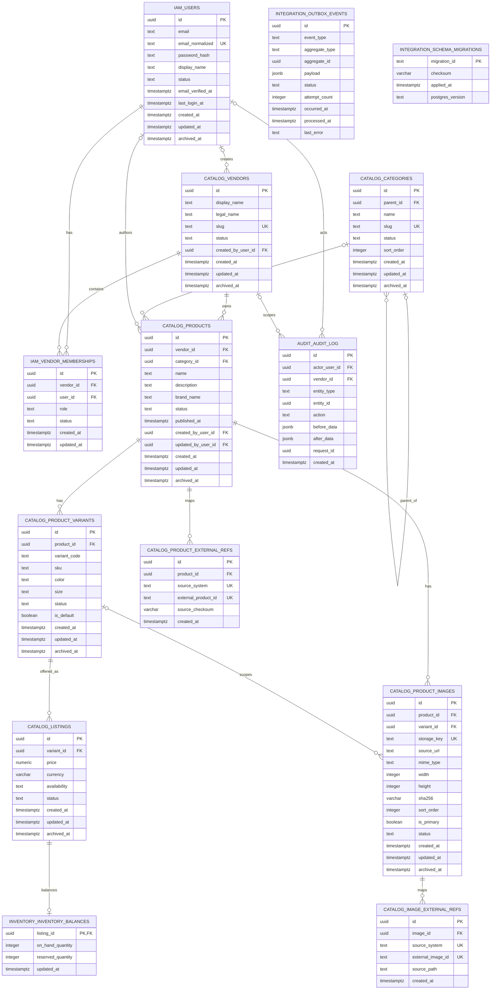

# Database ERD V1

This Mermaid ERD reflects `20260910_001_catalog_core_v1`. It intentionally excludes deferred
RefreshSession, Search, Commerce, Analytics, FTS, and vector infrastructure.

Notes:

- The image-to-variant relationship is implemented as composite FK `(variant_id, product_id)` to
  ensure Product consistency.
- External-reference uniqueness is composite by `(source_system, external_*_id)`; Mermaid's `UK`
  marker is descriptive at the field level.
- Outbox aggregate and Audit entity IDs are polymorphic UUID references, not foreign keys.
- `integration.schema_migrations` is migration infrastructure and has no domain relationship.
