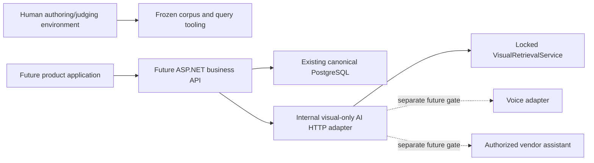

# Parallel engineering track V1

Status: architecture/dependency plan, not a replacement for accepted data/ML ADRs.
TEXT-QUERY-V1 tooling is independently frozen. B1 is now implemented by the separate
internal visual-only HTTP adapter ([contract](../API-VISUAL-V1.md)); voice/RAG/container
deployment and text retrieval remain unimplemented.

## Gate separation

| Boundary | Current state | What unblocks it |
| --- | --- | --- |
| TEXT-QUERY-V1 tooling | FROZEN / GREEN, software snapshot only | Version software changes without overwriting V1 |
| Human query dataset | PENDING, 0 genuine queries | Humans author/screen the frozen English query contract |
| Query dataset freeze | NOT POSSIBLE currently | >=40 valid queries, split/intent/class coverage and verified checksums |
| Human relevance dataset | PENDING | Two independent primary grades per query/Product pair plus disputed-pair adjudication |
| Text retrievers | BLOCKED | Genuine query and relevance freezes, then separate lexical/model decisions |
| Track B architecture | Can proceed without human text labels | Preserve data ownership, blinding and locked Visual V1 |

EVAL-TEXT-V1 remains preregistered and corpus-bound. PostgreSQL FTS is the frozen lexical
Baseline A; BM25 is unapproved. Tooling status and an empty human collection never unblock
text retrieval. No relevance judgments are inferred from products, images or commercial state.

## Shared system boundary

There is intentionally no runtime-to-authoring link. Authors, primary judges and adjudicators
must not see visual/text rankings, scores or generated relevance suggestions. Keep annotation
inputs/held-out labels out of runtime images, API examples and telemetry. Future visual endpoint
development uses synthetic non-benchmark inputs, never the pending human text query set.
These are process/deployment requirements, not claims of implemented access control.

The .NET backend owns identity, authorization, tenancy, business writes and catalog enrichment.
PostgreSQL remains business truth; source-controlled migrations own schema. The Python
research packages own deterministic projections/evidence and ML computation. The future AI
HTTP runtime is a thin adapter to approved services, not a second business backend.

## B1: minimal AI runtime / visual integration design

Start with lifecycle/readiness, request/response/error contracts and tests around the existing
visual service. Do not create parallel encoders, index logic or product aggregation. Existing
`src/sahulat_visual/retrieval.py` implements unique product results using MAX image similarity,
stable ties and encoder/index identity matching. `docs/http-integration.md` already describes
the integration boundary; the image endpoint is now implemented outside Visual V1.

Proposed eventual runtime ownership is one app boundary containing lifecycle/dependencies,
health/readiness, image DTOs/handler and safe error mapping. Initialize approved encoder/index
once per worker lifecycle, bound request bytes/decoding/concurrency, and atomically replace
compatible immutable index/service pairs. Expose no text route or pretend-empty text search.
No new authentication store or separate queue/cache/model-per-request architecture.

Public responses omit `ProductMatch.matched_image_path`; serialize only approved identity/evidence
fields. Current Visual V1 catalogue IDs must not be silently relabeled as canonical UUIDs.
The backend/integration adapter resolves source IDs via existing external references with
explicit source namespace, preserves visual rankings, then rechecks commercial visibility and
authorization. Khaadi draft listings lack authoritative Currency and must not be activated by
visual runtime integration. This resolution belongs in the adapter, not Visual V1 core.

Before implementation, freeze the HTTP/version contract, deployment trust boundary, startup
artifact requirements, request-size/concurrency limits and canonical-ID resolution tests.
Keep model/index compatibility failures as failed readiness, not fabricated empty results.
No model reselection, new visual embeddings or EVAL-VISUAL-V1 changes are required.

B1 now has a versioned OpenAPI snapshot, loopback-only CLI, bounded memory-only multipart
handling, once-per-worker cached assets, safe errors and synthetic endpoint/DB lineage tests.
The runtime always marks HTTP IDs as external and does not open the database. Backend identity
helpers are explicit/read-only, not authentication/publication logic. Parent authz, real deployment,
resource/SLO validation and integration of a future .NET gateway remain separate work.

## B2: deployment/containerization preparation

Separate reproducible offline research/annotation from an eventual CPU-first visual runtime.
Runtime images should exclude `.env`, PostgreSQL credentials, raw datasets, human queries,
judgments and held-out labels; mount/version approved model/index assets separately and do
not download/change models per request. Set resource/readiness boundaries and record cold
setup separately from query work. These are proposed policies, not a built/deployed image.

The existing PostgreSQL adapter discovers `psql` or honors `PSQL_PATH`; a future Linux offline
job must supply its own client/configuration, not copy a Windows executable path or local
`postgres` superuser connection into a runtime image. Do not create a new role/migration or
bundle business schema mutation into AI startup. Deployment target, asset distribution and
service credentials remain separate implementation choices.

## B3/B4: voice and vendor assistant boundaries

Voice design can define audio input limits, transcript provenance, language/error handling
and a transcription adapter contract without selecting/training an ASR model or adding text
retrieval. Recognized speech does not become a benchmark query. End-to-end voice product
search remains blocked on approved text retrieval; no voice route is promised here.

Vendor-assistant design can define authorized data-source boundaries and answer provenance.
Do not embed the entire database or let a model execute unrestricted SQL. Prefer deterministic
authorized read projections for structured business facts; decide later whether document RAG
or an LLM adds value. Offers/orders/sales/analytics are absent, so sales answers are currently
unsupported. Missing Currency/Stock or unavailable transaction history cannot be invented.
Real workflows, permissions, source coverage, privacy and evaluation require their own gate.

## Track A: human work remains independent

The suggested 10 people x 5 queries can provide ~50 raw submissions, not guaranteed 40 accepted
queries. Coordinator review must still satisfy independent intents, five class minima per split,
English scope, uniqueness and blinding. Keep author aliases private and preserve rejected-source
evidence. Query collection is separate from the minimum **32,000** primary-judge rows; no session
estimate for query authoring implies that exhaustive judging is complete.

After valid human queries freeze, collect independent manual judgments, adjudicate, then freeze
the genuine evaluation dataset. ADR-ML-002 remains a separate lexical-configuration decision;
no current parallel engineering work may select/tune a text retriever against held-out labels.

## Next bounded implementation candidate

B1's visual-only adapter is implemented. Next separately authorized Track B work can address
deployment/asset distribution or the future backend trust boundary; no next gate is started
automatically. Text FTS/dense/RRF, voice/RAG, Commerce and benchmark results remain blocked.
